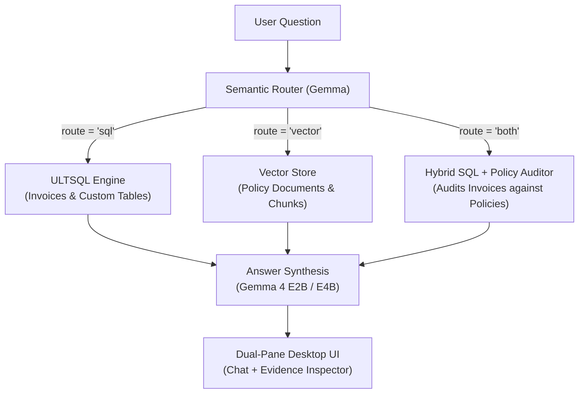

# Wayfinder

> **Privacy-First Offline Database & Document Agent**  
> Pair local embedded SQL with local open-weight language models for zero-cloud business intelligence and policy audits.

---

## Why Offline Matters

In enterprise finance, healthcare, legal analysis, and sensitive internal operations, confidential invoices, proprietary contracts, and internal governance policies cannot be sent to third-party cloud AI APIs without severe compliance risks and data leak liabilities. **Wayfinder ensures that sensitive company data never leaves the laptop.** All relational database queries, semantic vector embeddings, and neural reasoning happen entirely on-device using local open-weight models (Google Gemma) and an embedded relational database (ULTSQL). Your data remains 100% private, accessible offline, with zero external network requests and zero cloud tokens.

---

## Architecture

Wayfinder employs a dual-engine architecture: structured data is queried with standard SQL through ULTSQL, while unstructured policy guidelines are retrieved via dense vector similarity. A semantic router classifies user intent into dedicated skills.



---

## Key Features

- **Local Embedded Database**: Powered by `ULTSQL`, executing fast SQL transactions directly in-process with zero external database processes.
- **Universal Data Ingestion**:
  - Drag-and-drop any `.csv`, `.json`, `.txt`, or `.md` file directly into the application window or use the **Add Data** button.
  - Automatically parses columns, infers data types (`INTEGER`, `REAL`, `TEXT`), sanitizes table names, and builds dynamic relational tables.
  - Automatically chunks, embeds, and indexes text documents offline into the vector store.
- **Dynamic Schema Registry**: Router and SQL generation prompts are dynamically synthesized at runtime based on active registered tables and document sources.
- **Multi-Turn Conversation Memory**: Retains conversation history within each session for fluid follow-up inquiries.
- **Multi-Chat Sessions & History**: Easily spin up new chats, switch between past conversations, or delete obsolete sessions.
- **Transparent Evidence Pane**: Inspect the live routing chip, step-by-step reasoning checklist, generated SQL query, raw result rows, and policy excerpts with similarity scores.
- **One-Click Export**: Export results and evidence directly to **CSV** or styled **PDF reports**.

---

## Quick Start & Setup Guide

### 1. Prerequisites
- **Flutter SDK**: Version 3.24+ (with Dart 3.5+) installed and added to `PATH`.
- **Windows Desktop Support**: Ensure Visual Studio Desktop C++ workload is installed (`flutter doctor`).
- **LM Studio**: Download and install [LM Studio](https://lmstudio.ai/) for running local open-weight models.

### 2. Configure Models in LM Studio
Open LM Studio and download the following two local models:

1. **Language Model (LLM)**:
   - Search for `google/gemma-2-2b-it` or `gemma-4-e2b` / `gemma-4-e4b` (GGUF Q4_K_M or Q4_0 recommended).
   - Alternatively, any instruction-tuned local model supported by LM Studio.
2. **Embedding Model**:
   - Search for `text-embedding-nomic-embed-text-v1.5` (or any standard text embedding model).

### 3. Start LM Studio Local Inference Server
1. In LM Studio, click on the **Developer / Local Server** tab (the `<->` icon on the left).
2. Under **Model Selection**, load your downloaded Gemma model.
3. Under **Server Port**, set port to `1235` (or keep `1234` and configure `lib/config.dart`).
4. Ensure **Enable CORS** is toggled **ON**.
5. Click **Start Server**.

### 4. How ULTSQL Works
Wayfinder uses `ultsql: ^1.0.29`, a pure-Dart, source-available relational and vector database engine. There are **zero native C++ dependencies or database servers to install**—it is installed automatically via Flutter dependencies:
```bash
cd wayfinder
flutter pub get
```

### 5. Configure Wayfinder
Open `lib/config.dart` and verify the settings match your LM Studio server:
```dart
class Config {
  static const String baseUrl = 'http://localhost:1235/v1';
  static const String chatModel = 'google/gemma-4-e4b'; // or your loaded model identifier
  static const String embedModel = 'text-embedding-nomic-embed-text-v1.5';
  static const Duration timeout = Duration(seconds: 60);
}
```

### 6. Run the Application
Launch Wayfinder in native Windows desktop mode:
```bash
flutter run -d windows
```

To build a standalone production release locally:
```bash
flutter build windows --release
```

### 7. Pre-Built Windows Executable (CI/CD)
Every push to `main` automatically builds and packages the complete standalone Windows application via GitHub Actions:
- **Download Artifact**: Head to the [GitHub Actions tab](https://github.com/ompatel3158/wayfinder/actions), select the latest run, and download **`wayfinder-windows-x64.zip`**.
- **Run**: Unzip the archive and double-click **`wayfinder.exe`**—no Flutter installation required!

---

## Demo Questions

Try these built-in demo questions to test each skill:

1. **SQL Skill**:
   > *"What is the total refund amount for Travel?"*  
   > *Routes to `sql` -> generates `SELECT SUM(refund_amount) FROM invoices WHERE category = 'Travel';` -> displays result rows and summary.*

2. **Vector Skill**:
   > *"How many days do I have to request a refund?"*  
   > *Routes to `vector` -> searches embedded policy documents -> extracts rule from `refund_policy.md` (30 days).*

3. **Hybrid Skill ("Both")**:
   > *"Which invoices break the refund policy?"*  
   > *Routes to `both` -> retrieves the 30-day limit rule -> generates SQL querying invoices with `refund_days > 30` -> synthesizes the audited violation report.*

---

## Repository Structure

```
wayfinder/
├── assets/
│   ├── data/             # Default demo invoices (CSV) and policies (Markdown)
│   └── fonts/            # Bundled Inter and JetBrains Mono fonts
├── docs/
│   └── limitations.md    # Known limitations and architectural boundaries
├── lib/
│   ├── agent.dart        # Semantic routing, SQL generation, and answer synthesis
│   ├── config.dart       # Local model endpoints and model configuration
│   ├── db.dart           # ULTSQL database driver & in-memory vector index
│   ├── export.dart       # CSV and PDF document generation
│   ├── ingest.dart       # Ingestion pipelines for CSV, JSON, TXT, and MD files
│   ├── llm.dart          # Local HTTP client for LM Studio OpenAI-compatible API
│   ├── main.dart         # Flutter desktop UI, sessions, drop target & evidence pane
│   └── registry.dart     # Dynamic schema and document metadata registry
├── test/                 # Comprehensive unit and integration test suite
├── skills.md             # Detailed specification of agent skills
└── README.md
```

---

## Attribution & License

Built on ULTSQL (FSL-1.1-MIT, source-available, pre-existing) and open-weight Gemma. The Wayfinder agent was built during Hacktoberfest Hack Day. Wayfinder's own code is MIT (see LICENSE).
